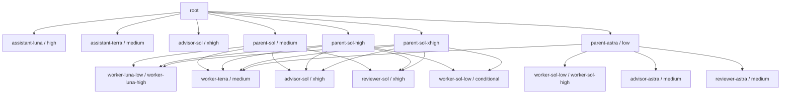

# Codexエージェントチーム

職能別ロールを廃止し、Parentに残る判断の深さに応じて選ぶ。統括判断が限定された案件はSol / mediumを基本とし、文章・画像・画面を中心とする局所実行にはTerra / medium workerを使える。深い全体判断にはSol / highまたはxhigh、特に難しい全体統合判断にはAstra / lowを候補にする。案件の規模や実行部分の難しさだけでParentをhigh以上にしない。現設定の根拠と変更経緯は [モデル選択資料](codex-agent-model-selection.md) に記録する。

## 階層と役割

階層は案件の責任範囲、役割は担当する仕事を表す。root / parent / childの関係と、worker / advisor / reviewerの役割を分けて読む。

| 階層 | 責任 | 対応する担当 |
| --- | --- | --- |
| root | ユーザーとの対話、意図の解釈、担当選択、委任の有効性、成果への導線 | この会話を受け持つエージェント。専用の起動ロールは定義しない |
| parent | 案件の企画、分割・指示、childの受入、統合、独立レビューの手配 | `parent-sol` / `parent-sol-high` / `parent-sol-xhigh` / `parent-astra` |
| child | 指定範囲の仕事を返す末端担当。再委任しない | worker / advisor / reviewer。root直轄のassistant・advisorも末端担当 |

| 役割 | 担当する仕事 | 成果の使い方 |
| --- | --- | --- |
| worker | 指示された範囲の調査・実行・検証 | parentが指示への適合を確認して統合する |
| advisor | 前提、方針、選択肢、成立条件の検討 | 依頼元が助言の採否を判断する |
| reviewer | 原依頼とparentの解釈・成果を独立評価 | ユーザーへ返せるかを判定する |
| assistant | rootが指定した検索・読解・抽出・要約 | rootが必要な結果と根拠を回収する |

## Parentの選択

| 案件 | parent | worker | advisor / reviewer |
| --- | --- | --- | --- |
| 統括判断が限定された案件（基本） | Sol / medium | Luna / low または high、Terra / medium | Sol / xhigh |
| 深い全体判断が必要 | Sol / high または xhigh | Luna / low または high、Terra / medium。方針確定・境界明確・受入容易な局所作業ならSol / lowも選択可能 | Sol / xhigh |
| 全体判断が難しい具体的な高難度 | Astra / low | Sol / low または high、Terra / medium | Astra / medium |

advisorとreviewerは同じ設定でも別個体で担当する。root直轄の補助は、検索・抽出・要約に `assistant-luna`（Luna / high）、画像・画面・文書レイアウトの読解に `assistant-terra`（Terra / medium）を使う。どちらも読み取り専用とし、相談は `advisor-sol`（Sol / xhigh）。全15ロールの識別子と設定は [モデル選択資料](codex-agent-model-selection.md) を参照する。

下図の矢印は起動・依頼の関係を示す。worker、advisor、reviewerの間に上下関係はない。

rootは意図を解釈し、目的・成果・範囲・受入条件と残る仕事を整理する。会話、確認済みの根拠に基づく説明、委任に必要な限定照合は直接扱う。実質的な調査・制作・実装は規模にかかわらずParentへ委任する。新しい仕事は目的・範囲・判断難度から担当を選び、継続・訂正は適合する元担当へ戻す。委任内容を定めてから製品別 `common/team.md` を確認する。直接回答だけで完結する場合は編成の確認を省ける。[root運用](../.chezmoitemplates/agent/team/root.md)

Parentへ渡す案件は、範囲・方針・受入条件を明確にでき、統括判断が限定されていればSol / mediumを基本にする。定型案件に限定せず、文章力や画像理解が必要な実行をTerraへ渡せる場合も含む。要求間の競合、原因分析、複数成果の難しい統合が残る場合はSol / highまたはxhigh、さらに具体的な高難度の全体判断が残る場合はAstra / lowを選ぶ。第三の編成は作らず、レビューの要否は影響と不確実性から判断する。実作業の承認境界は守る。

Parentはrootの全履歴から分離されているため、履歴分離だけを目的にworkerを起動しない。起動・引継ぎ・検査・再依頼を含めても完了時間または実効費用の改善が見込める独立した作業を委任する。rootのLuna補助はhigh固定。明示的なParent兼務時もLuna lowは使わない。Sol系Parentは、機械的に検査できる作業にはLuna、文章・画像・画面を中心とする局所実行にはTerraを選ぶ。Sol / high・xhigh Parentは、方針確定・境界明確・受入容易な局所作業ならSol / low workerも選べる。Astra ParentはSol low/highに加え、同じ局所条件でTerraを使える。小さな案件で委任の負担が勝るならParentが直接完結する。細部は [企画・統合](../.chezmoitemplates/agent/team/planning.md) と [Codexチーム設定](../dot_codex/common/team.md.tmpl) を参照する。

## 異なる二つの品質基準

| 担当 | 入力 | 評価するもの |
| --- | --- | --- |
| Parent | childへの指示と結果 | 指示への適合、工程・内容・根拠・検証の妥当性 |
| Reviewer | Parentへの原依頼、解釈・方針、計画または最終成果 | ユーザー意図、論理の根幹、重要要求の充足、返却可能性 |

Parentはchildの受入時に要求を再解釈しない。指示が悪ければ指示の修正として扱う。Reviewerは細かな指摘数を成果にせず、結論や利用可能性を損なう問題に集中する。

独立レビューの要否・対象・時点は、重大な影響、判断の不確実性、別の視点の有効性から決める。計画・最終成果への一律起動や形式的な二段階レビューは求めず、明示要件は守る。行う場合は作成・助言に不参加のReviewerを使い、助言履歴で誘導しない。見解相違が解消しなければParentがユーザーに確認する。判断と進行は [企画・統合](../.chezmoitemplates/agent/team/planning.md)、共通境界は [原理原則](../.chezmoitemplates/agent/rules/core.md) を正本とする。

## 不足・不満への対応

本人が正しい・十分だと判断していても、不足・不満には指摘の射程と具体性に応じて対応する。狭域・具体的に改善点が絞られている場合は、対応速度を重視して元担当が修正する。rootの直接回答はroot、Parentの成果は元Parentが継続し、説明だけで修正を終えない。修正の難度でこの分岐を変更しない。

広域・抽象的で具体的な改善点を特定しきれない場合は、別個体へ交代し、視点を変えて原依頼への回答を抜本的に再構成する。本人の誤りの認定や不満の妥当性の判定を待たず、前回答の正しさを新担当の前提にしない。広域指摘を言換えに縮小して交代を避けず、射程・具体性を判断できない場合は指摘範囲を未確定として確認する。原依頼・対象回答・指摘原文・確認済みの根拠と権限を切り出して渡す。詳細は [root運用](../.chezmoitemplates/agent/team/root.md) と [企画・統合](../.chezmoitemplates/agent/team/planning.md) が正本である。

担当交代するCodex案件ではrootが適切な別Parentを起動する。旧Parentが配下に別Parentを起動する二重の担当構造にはしない。必要な独立レビューは別個体のReviewerが行い、Advisorだけで修復を終えたり、Reviewerを作成担当にしたりしない。固定ロールと実在する起動方法は [Codexチーム設定](../dot_codex/common/team.md.tmpl) で確認する。

担当交代するClaude案件ではrootが編成・仲介に残り、別workerが指定範囲の回答を再作成する。必要な独立レビューでは原要求と指摘への充足を判定する。rootが旧回答の正当化や補完へ戻らない分担にし、存在しないParentを起動しない。狭域・具体的な修正は元rootまたはworkerが継続する。必要な範囲・権限を担保できない場合は不足を返す。製品固有の責任と制約は [Claudeチーム設定](../private_dot_claude/common/team.md.tmpl) を参照する。

追加担当によるリトライは広域・抽象的な不足に限り、狭域・具体的な修正では元担当が継続する。必要な独立レビューでは、独立性を保てる既存Reviewerも再利用できる。通常の軽微な回答へ毎回追加担当を置く仕組みや、実行側による強制的な入力・終了制御の実装ではない。遵守や時間・費用の改善は未検証である。

## 情報と成果の流れ

エージェント間の委任・報告・質問・訂正は英語で行い、引用する原文は元の言語を保つ。指示6項目、報告5項目の意味は [共通インターフェース](../.chezmoitemplates/agent/team/interface.md) を正本とする。全専用設定へ直接includeし、root・兼務Parentは初回委任前に `common/interface.md` を読む。人への説明は日本語で結論を先に伝える。[原理原則](../.chezmoitemplates/agent/rules/core.md)

記入例と設計参考は[委任・回答の記入例](agent-interface-examples.md)を参照。

### 案件全体の流れ

外部担当が必要な通常の実作業では次の順で進む。

1. rootが意図を解釈し、原文・確定条件・権限と、目的・完了条件・判断の範囲をparentへ渡す。方針の検討が必要なら、仮説・比較軸・推奨など何を検討するかを示す。
2. parentがrootの確定条件を引き継ぎ、実質的な調査・仮説の検証・方針判断を担う。委任が有効なら、workerが完遂できる成果・範囲・裁量・検証方法を示す。workerは局所判断を行い、条件の矛盾や実現困難はparentへ返す。
3. parentがworkerの結果を受け入れ、案件全体の成果へ統合する。
4. 独立レビューが必要なら、別個体のreviewerが原依頼・解釈・成果を評価する。要修正・判定不能ならparentが対応し、再確認を受ける。
5. parentが結論・検証・限界と成果物への導線をrootへ返す。rootは進捗・返却を完了条件に照らし、必要な補完を依頼して、結論からユーザーに伝える。

計画レビューは重大な影響や不確実性を実作業前に減らせる場合に選ぶ。計画を返すことや作業量だけで必須にしない。rootがparentを兼務する場合は意図の整理と実質的な仕事の両方を担う。Codexで明示兼務する場合のLunaはhigh固定。Claudeのrootは常にParentを兼務し、必要な局所作業を配下へ委任できる。実作業承認が曖昧なら確認し、明確なら形式的な再承認を足さない。

共有済みログ・検証は再利用する。難しい作業の並列化を標準手順にはしない。情報共有方式の詳細再編はTODOとし、現段階では案件別作業領域と必要な状態・レビュー記録を維持する。

## 正本

- [原理原則](../.chezmoitemplates/agent/rules/core.md)：全担当の常設境界
- [root運用](../.chezmoitemplates/agent/team/root.md)：担当選択・引継ぎ・不足対応・承認仲介
- [企画・統合](../.chezmoitemplates/agent/team/planning.md)：Parentの要求整理・設計・委任・child受入・検証計画・レビュー
- [実作業導線](../.chezmoitemplates/agent/engineering/implementation.md)：workerと自ら実作業するParent/rootの条件読込
- [操作手順](../.chezmoitemplates/agent/rules/operations.md)：操作・記録前の条件読込
- [Codexチーム設定](../dot_codex/common/team.md.tmpl)：製品別の編成表・識別子・モデル対応
- [Worker](../.chezmoitemplates/agent/team/worker.md)、[Advisor](../.chezmoitemplates/agent/team/advisor.md)、[Reviewer](../.chezmoitemplates/agent/team/reviewer.md)：担当別規範
- [設定と決定根拠](codex-agent-model-selection.md)：暫定設定・変遷・受入ケース

本資料はCodex編成の説明であり、運用時に別の条件を追加する正本ではない。Claudeも共通の担当・レビュー原則を使い、製品別の起動方法は末端テンプレートが定める。
