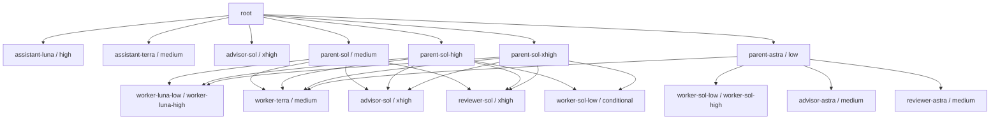

# Codexエージェントチーム

職能別ロールを廃止し、Parentに残る判断の深さに応じて選ぶ。統括判断が限定された案件はSol / mediumを基本とし、文章・画像・画面を中心とする局所実行にはTerra / medium workerを使える。深い全体判断にはSol / highまたはxhigh、特に難しい全体統合判断にはAstra / lowを候補にする。案件の規模や実行部分の難しさだけでParentをhigh以上にしない。現設定の根拠と変更経緯は [モデル選択資料](codex-agent-model-selection.md) に記録する。

## 階層と役割

階層は案件の責任範囲、役割は担当する仕事を表す。root / parent / childの関係と、worker / advisor / reviewerの役割を分けて読む。

| 階層 | 責任 | 対応する担当 |
| --- | --- | --- |
| root | ユーザーとの対話、課題設定、承認、結果の返却。委任モードではParentの選定と受入、Parent兼務モードでは企画・統合も担う | この会話を受け持つエージェント。専用の起動ロールは定義しない |
| parent | 案件の企画、分割・指示、childの受入、統合、独立レビューの手配 | `parent-sol` / `parent-sol-high` / `parent-sol-xhigh` / `parent-astra` |
| child | 指定範囲の仕事を返す末端担当。再委任しない | worker / advisor / reviewer。root直轄のassistant・advisorも末端担当 |

| 役割 | 担当する仕事 | 成果の使い方 |
| --- | --- | --- |
| worker | 指示された範囲の調査・実行・検証 | parentが指示への適合を確認して統合する |
| advisor | 前提、方針、選択肢、成立条件の検討 | 依頼元が助言の採否を判断する |
| reviewer | 原依頼とparentの解釈・成果を独立評価 | ユーザーへ返せるかを判定する |
| assistant | rootが指定した検索・読解・抽出・要約 | rootが必要な結果と根拠を回収する |

## Parentの選択

| 案件 | parent | worker | advisor / reviewer |
| --- | --- | --- | --- |
| 統括判断が限定された案件（基本） | Sol / medium | Luna / low または high、Terra / medium | Sol / xhigh |
| 深い全体判断が必要 | Sol / high または xhigh | Luna / low または high、Terra / medium。方針確定・境界明確・受入容易な局所作業ならSol / lowも選択可能 | Sol / xhigh |
| 全体判断が難しい具体的な高難度 | Astra / low | Sol / low または high、Terra / medium | Astra / medium |

advisorとreviewerは同じ設定でも別個体で担当する。root直轄の補助は、検索・抽出・要約に `assistant-luna`（Luna / high）、画像・画面・文書レイアウトの読解に `assistant-terra`（Terra / medium）を使う。どちらも読み取り専用とし、相談は `advisor-sol`（Sol / xhigh）。全15ロールの識別子と設定は [モデル選択資料](codex-agent-model-selection.md) を参照する。

下図はCodexの既定である委任モードでの起動・依頼を示す。worker、advisor、reviewerの間に上下関係はない。

モードはチャット開始時のユーザー指定で決まる。既定はCodexが委任、ClaudeがParent兼務で、同じチャットでは切り替えない。rootは両モードで意図、課題、目的、受入条件を整理する。課題の仮説では構成要素と関係を示し、大半の要素を該当領域の先例やベストプラクティスに結び付ける。判断に必要な根拠が欠ける場合に調査や委任で補う。[root共通運用](../.chezmoitemplates/agent/team/root.md)

委任モードのrootは会話、確認済みの根拠に基づく説明、委任に必要な限定照合を直接扱う。実質的な調査・制作・実装は規模にかかわらずParentへ委任し、進捗と成果を受入条件に照らす。新しい仕事は目的・範囲・判断難度から担当を選び、継続・訂正は適合する元担当へ戻す。委任内容を定めてから製品別 `common/team.md` を確認する。[委任モード](../.chezmoitemplates/agent/team/root-delegate.md)

Parent兼務モードのrootは企画・統合を担い、必要に応じて局所作業をchildに任せる。兼務での続行が適さない場合は引継ぎを用意し、独立したParentを起動できる環境で新しい委任モードのチャットを案内する。起動先が不明または確保できない場合は不足を伝える。[Parent兼務モード](../.chezmoitemplates/agent/team/root-parent.md)

Parentへ渡す案件は、範囲・方針・受入条件を明確にでき、統括判断が限定されていればSol / mediumを基本にする。定型案件に限定せず、文章力や画像理解が必要な実行をTerraへ渡せる場合も含む。要求間の競合、原因分析、複数成果の難しい統合が残る場合はSol / highまたはxhigh、さらに具体的な高難度の全体判断が残る場合はAstra / lowを選ぶ。第三の編成は作らず、レビューの要否は影響と不確実性から判断する。実作業の承認境界は守る。

Parentはrootの全履歴から分離されているため、履歴分離だけを目的にworkerを起動しない。起動・引継ぎ・検査・再依頼を含めても完了時間または実効費用の改善が見込める独立した作業を委任する。rootのLuna補助はhigh固定。明示的なParent兼務時もLuna lowは使わない。Sol系Parentは、機械的に検査できる作業にはLuna、文章・画像・画面を中心とする局所実行にはTerraを選ぶ。Sol / high・xhigh Parentは、方針確定・境界明確・受入容易な局所作業ならSol / low workerも選べる。Astra ParentはSol low/highに加え、同じ局所条件でTerraを使える。小さな案件で委任の負担が勝るならParentが直接完結する。細部は [企画・統合](../.chezmoitemplates/agent/team/planning.md) と [Codexチーム設定](../dot_codex/common/team.md.tmpl) を参照する。

## 異なる二つの品質基準

| 担当 | 入力 | 評価するもの |
| --- | --- | --- |
| Parent | childへの指示と結果 | 指示への適合、工程・内容・根拠・検証の妥当性 |
| Reviewer | Parentへの原依頼、解釈・方針、計画または最終成果 | ユーザー意図、論理の根幹、重要要求の充足、返却可能性 |

Parentはchildの受入時に要求を再解釈しない。指示が悪ければ指示の修正として扱う。Reviewerは細かな指摘数を成果にせず、結論や利用可能性を損なう問題に集中する。

独立レビューの要否・対象・時点は、重大な影響、判断の不確実性、別の視点の有効性から決める。計画・最終成果への一律起動や形式的な二段階レビューは求めず、明示要件は守る。行う場合は作成・助言に不参加のReviewerを使い、助言履歴で誘導しない。見解相違が解消しなければParentがユーザーに確認する。判断と進行は [企画・統合](../.chezmoitemplates/agent/team/planning.md)、共通境界は [原理原則](../.chezmoitemplates/agent/rules/core.md) を正本とする。

## 不足・不満への対応

ユーザーが不足や不満を示すか、再試行を求めたときに復旧手順を読む。狭域で具体的な指摘は元担当が修正する。広域・抽象的で改善点を絞れない場合は、別個体が原依頼から再構成する。委任モードでは別Parentに、Parent兼務モードでは独立して引き受けられる範囲を別workerに渡す。兼務root自身の判断や案件全体を見直す場合は、ユーザーが開始する新しい委任モードのチャットに引き継ぐ。[修正と再試行](../.chezmoitemplates/agent/team/recovery.md)

独立レビューが必要な場合は、独立性を保てるReviewerが原要求と指摘への充足を判定する。製品ごとの起動方法と利用可能な担当は編成表で確認する。[企画・統合](../.chezmoitemplates/agent/team/planning.md)・[Codexチーム設定](../dot_codex/common/team.md.tmpl)・[Claudeチーム設定](../private_dot_claude/common/team.md.tmpl)

## 情報と成果の流れ

エージェント間の委任・報告・質問・訂正は英語で行い、引用する原文は元の言語を保つ。指示6項目、報告5項目の意味は [共通インターフェース](../.chezmoitemplates/agent/team/interface.md) を正本とする。全専用設定へ直接includeし、root・兼務Parentは初回委任前に `common/interface.md` を読む。人への説明は日本語で結論を先に伝える。[原理原則](../.chezmoitemplates/agent/rules/core.md)

記入例と設計参考は[委任・回答の記入例](agent-interface-examples.md)を参照。

### 案件全体の流れ

委任モードで外部担当が必要な通常の実作業では次の順で進む。

1. rootが意図を解釈し、原文・確定条件・権限と、目的・完了条件・判断の範囲をparentへ渡す。方針の検討が必要なら、仮説・比較軸・推奨など何を検討するかを示す。
2. parentがrootの確定条件を引き継ぎ、実質的な調査・仮説の検証・方針判断を担う。委任が有効なら、workerが完遂できる成果・範囲・裁量・検証方法を示す。workerは局所判断を行い、条件の矛盾や実現困難はparentへ返す。
3. parentがworkerの結果を受け入れ、案件全体の成果へ統合する。
4. 独立レビューが必要なら、別個体のreviewerが原依頼・解釈・成果を評価する。要修正・判定不能ならparentが対応し、再確認を受ける。
5. parentが結論・検証・限界と成果物への導線をrootへ返す。rootは進捗・返却を完了条件に照らし、必要な補完を依頼して、結論からユーザーに伝える。

計画レビューは重大な影響や不確実性を実作業前に減らせる場合に選ぶ。計画を返すことや作業量だけで必須にしない。CodexでParentを兼務する場合のLunaはhigh固定。実作業承認が曖昧なら確認し、明確な承認は再利用する。

共有済みログ・検証は再利用する。難しい作業の並列化を標準手順にはしない。情報共有方式の詳細再編はTODOとし、現段階では案件別作業領域と必要な状態・レビュー記録を維持する。

## 正本

- [原理原則](../.chezmoitemplates/agent/rules/core.md)：全担当の常設境界
- [root共通運用](../.chezmoitemplates/agent/team/root.md)は課題設定・承認・報告を定める。
- [委任モード](../.chezmoitemplates/agent/team/root-delegate.md)はParentの選定・受入、[Parent兼務モード](../.chezmoitemplates/agent/team/root-parent.md)は企画への導線と引継ぎを定める。
- [修正と再試行](../.chezmoitemplates/agent/team/recovery.md)は元担当の継続と別担当への交代を定める。
- [企画・統合](../.chezmoitemplates/agent/team/planning.md)：Parentの要求整理・設計・委任・child受入・検証計画・レビュー
- [実作業導線](../.chezmoitemplates/agent/engineering/implementation.md)：workerと自ら実作業するParent/rootの条件読込
- [操作手順](../.chezmoitemplates/agent/rules/operations.md)：操作・記録前の条件読込
- [Codexチーム設定](../dot_codex/common/team.md.tmpl)：製品別の編成表・識別子・モデル対応
- [Worker](../.chezmoitemplates/agent/team/worker.md)、[Advisor](../.chezmoitemplates/agent/team/advisor.md)、[Reviewer](../.chezmoitemplates/agent/team/reviewer.md)：担当別規範
- [設定と決定根拠](codex-agent-model-selection.md)：暫定設定・変遷・受入ケース

本資料はCodex編成の説明であり、運用時に別の条件を追加する正本ではない。Claudeも共通の担当・レビュー原則を使い、製品別の起動方法は末端テンプレートが定める。
